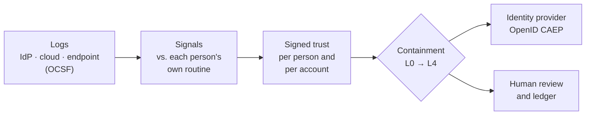

<div align="center">

<a href="https://xevorislabs.com">
  <picture>
    <source media="(prefers-color-scheme: dark)" srcset="https://raw.githubusercontent.com/amarkralj/NullProtocol-Negative-Trust-Architecture/main/.github/assets/xevoris-labs-dark.png">
    
  </picture>
</a>

# NullProtocol Negative Trust Architecture

**Trust that can fall below zero. An extension of zero trust for insider threats.**

[](LICENSE)
[](CHANGELOG.md)
[](https://github.com/amarkralj/NullProtocol-Negative-Trust-Architecture/actions/workflows/ci.yml)
[](pyproject.toml)
[](https://xevorislabs.com)

[**Website**](https://xevorislabs.com) · [Quick start](#quick-start) · [Eight real attacks](#eight-documented-attacks-reconstructed-and-detected) · [Results](#results) · [Documents](#documents) · [Contact](#contact)

</div>

---

Zero trust (NIST SP 800-207) checks every request, but it leaves open how much a person or an account should be
trusted once they are inside. **NullProtocol Negative Trust** fills that gap with a trust algorithm built for insider
threats, by [Xevoris Labs](https://xevorislabs.com).

|  |  |
|---|---|
| **Signed trust** | Trust starts at zero, rises slowly with normal behaviour, falls quickly with evidence of misuse and can become negative. |
| **Long memory for misuse** | Misuse is remembered longer than good behaviour; decoys test suspicion actively. |
| **Right attribution** | Evidence lands on whoever it is about: a hijacked *account* is contained without blaming its *owner*. |
| **Reversible containment** | L0 observe → L1 verify → L2 dual control → L3 read-only → L4 isolate. People review every serious case. |
| **Private by design** | Pseudonymous by default, with a tamper-evident ledger of every decision. |
| **Fits your stack** | OCSF events in, OpenID CAEP signals out; adapters for Okta, Entra ID, Microsoft 365, AWS CloudTrail and Windows. |



## Eight documented attacks, reconstructed and detected

Each attack path is rebuilt step by step from public reporting inside a simulated organisation, next to harmless
look-alikes such as genuine password resets and support staff working tickets. Tested on 20 simulated organisations
not used during development.

| Incident | Attack path | Detection | Result |
|---|---|---|---|
| [**MGM Resorts** (2023)](https://www.bloomberg.com/news/articles/2023-09-16/mgm-resorts-hackers-broke-in-after-tricking-it-service-desk) | Help desk resets a privileged user's MFA; new identity provider added | Reset followed by a new-device sign-in | ✅ 20 / 20 contained · 100 % of data stopped |
| [**Uber** (2022)](https://www.infoq.com/news/2022/09/Uber-breach-mfa-fatigue) | MFA push prompts repeated until one is approved | Push bombing, then a new-device sign-in | ✅ 20 / 20 contained · 100 % of data stopped |
| [**Okta support** (2023)](https://www.bleepingcomputer.com/news/security/okta-breach-134-customers-exposed-in-october-support-system-hack/) | Admin session token from a support file replayed | Session presented by a different client | ✅ 20 / 20 contained · 100 % of data stopped |
| [**Snowflake** (2024)](https://techcrunch.com/2024/06/05/snowflake-customer-passwords-found-online-Infostealing-malware/) | Old password from an infostealer log, no MFA, bulk export | Dormant account reused without MFA | ✅ 20 / 20 contained · 100 % of data stopped |
| [**Salesloft Drift** (2025)](https://securityaffairs.com/?p=181632) | Integration OAuth token used to export data and search it for keys | Integration on a new network, secret searches | ✅ 20 / 20 contained · 91 % of data stopped |
| [**Coinbase** (2024/25)](https://www.theregister.com/2025/05/21/coinbase_confirms_insider_breach_affects/) | Bribed support agents look up customer records | Look-ups without an assigned ticket | ✅ 20 / 20 contained · 94 % of data stopped |
| [**Cash App** (2022)](https://www.upguard.com/blog/how-did-the-cash-app-data-breach-happen) | Former employee keeps access and downloads reports | Activity after the employment end date | ✅ 20 / 20 contained · 100 % of data stopped |
| [**KnowBe4** (2024)](https://cyberscoop.com/cyber-firm-knowbe4-hired-a-fake-it-worker-from-north-korea/) | Fake remote hire runs an infostealer on the company laptop | Endpoint findings as evidence | ✅ 20 / 20 contained · 100 % of data stopped |

Reconstructions in simulation, not the original breach data. Details: [docs/08-real-world-cases.md](docs/08-real-world-cases.md).

## Results

| Test | Result |
|---|---|
| Okta attack logs ([splunk/attack_data](https://github.com/splunk/attack_data)) | **15 / 15** attack types detected |
| Microsoft Entra ID, Microsoft 365 and AWS attack logs (splunk/attack_data) | **89 / 105** detected on the first run |
| Windows credential theft ([OTRF Security-Datasets](https://github.com/OTRF/Security-Datasets)) | **20 / 23** detected |
| Golden SAML, forged federation token (OTRF) | detected, evidence on the impersonated administrator |
| CERT insider threat datasets r4.2, r6.2, r6.1 (Carnegie Mellon) | **3 / 3**: at least as many insiders found as our strongest zero-trust baseline, fewer innocent users restricted |

<details>
<summary><b>CERT insider threat datasets in detail</b></summary>

<br>

Replayed in shadow mode. Each cell: insiders detected / share of incident activity prevented / innocent users
restricted (read-only or more) per 1,000.

| | r4.2 (1,000 users) | r6.2 (4,000 users) | r6.1 (4,000 users, held out) |
|---|---|---|---|
| Zero-trust baseline + correlation + decoys* | 36 % / 44.8 % / 14.0 | 0 of 5 / 0 % / 1.8 | 0 of 5 / 0 % / 1.0 |
| same, with our v0.9 signals* | 26 % / 50.0 % / 12.9 | 1 of 5 / 58.1 % / 24.8 | 1 of 5 / 44.3 % / 16.5 |
| **Zero trust + NullProtocol Negative Trust v0.9** | **50 % / 40.4 % / 10.8** | **1 of 5 / 32.2 % / 11.0** | **1 of 5 / 36.4 % / 11.8** |

The baseline restricts earlier and so stops more of each incident. Every architecture was calibrated without labels
to the same restriction budget, fixed before testing; r6.1 was not used until the final test.

\* Baselines are our own re-implementations of zero-trust and UEBA designs in the same engine, with the same
enforcement points, tested with their own signals and with ours. They are not commercial products.

</details>

Full method, every version, the limits and the misses: [docs/04-evaluation.md](docs/04-evaluation.md) ·
raw numbers in [results/](results/) ([summary](results/RESULTS.md)) · every result can be regenerated with
[scripts/](scripts/). Identities from public datasets are pseudonymised.

> **Status: v0.9, research prototype.** Tested in simulation, on recorded attack logs and on three CERT datasets.
> Not yet deployed in a real organisation; a shadow-mode pilot is next.

## Quick start

```bash
python -m venv .venv && . .venv/bin/activate
pip install -e ".[dev]"
npcore selftest                                  # end-to-end check, prints PASS/FAIL
npcore demo --scenario compromised               # a hijacked account being contained, step by step
```

Plug it into a system ([docs/06-integration.md](docs/06-integration.md)):

```bash
npcore check-ocsf events.jsonl --directory directory.json     # how much of your data it can use
npcore serve --directory directory.json                       # HTTP service: POST /v1/events, GET /v1/caep
docker build -t npcore . && docker run -p 8080:8080 -v $PWD/directory.json:/config/directory.json npcore
```

```python
from npcore.api import NegativeTrust

nt = NegativeTrust("directory.json")
outputs = nt.process(ocsf_record)      # decisions, containment changes, CAEP events
```

Reproduce the results: `python scripts/evaluate_release.py sim` (also `cert`, `scale`; CERT needs
`sh scripts/fetch_cert.sh`), then `npcore report`.

## Documents

| | |
|---|---|
| [00 Prior art](docs/00-prior-art.md) | What exists and what is new |
| [01 NullProtocol Negative Trust](docs/01-negative-trust.md) | Definition, principles, formal model, threat model |
| [02 Reference architecture](docs/02-reference-architecture.md) | Extension of NIST SP 800-207: components, sequences, deployment |
| [03 Metrics](docs/03-metrics.md) | Harm, speed, fairness, friction, accountability |
| [04 Evaluation](docs/04-evaluation.md) | Method, results, version comparison, limits |
| [05 Privacy and legal considerations](docs/05-privacy-and-legal.md) | EU and US law |
| [05a Works agreement outline](docs/05a-works-agreement-outline.md) | Template for employee representatives |
| [06 Integration](docs/06-integration.md) | OCSF in, CAEP out, Python API, HTTP service, Docker |
| [07 Roadmap](docs/07-roadmap.md) | What comes next |
| [08 Real-world cases](docs/08-real-world-cases.md) | Eight documented incidents, reproduced and detected |
| [Changelog](CHANGELOG.md) | Every version since v0.1 |

## Contact

* **Website:** [xevorislabs.com](https://xevorislabs.com)
* **Questions, pilots, commercial licences:** contact@xevorislabs.com
* **Issues and contributions:** see [CONTRIBUTING.md](CONTRIBUTING.md)
* **Security issues:** please report privately, see [SECURITY.md](SECURITY.md)

## Licence

Everything in this repository, code, documents and results, is licensed under the
[GNU Affero General Public License v3.0](LICENSE) (AGPL-3.0-only).

* **Free to use:** you may use, study, change and share it, including inside a company.
* **Share alike:** if you distribute it, or offer it to others over a network as part of a product or service, you
  must publish your complete source code under the same licence.
* **Commercial licence:** to build NullProtocol Negative Trust into a closed product or service without the AGPL
  obligations, contact **contact@xevorislabs.com**.

The Xevoris Labs name and logo are not covered by the licence. Third-party datasets are credited in
[NOTICE](NOTICE) and are not redistributed. To cite this work, see [CITATION.cff](CITATION.cff).

Deploying anything like this requires informing employees and, depending on the jurisdiction, an impact assessment and
an agreement with employee representatives ([doc 05](docs/05-privacy-and-legal.md)).

<div align="center">
<sub>Built by <a href="https://xevorislabs.com">Xevoris Labs</a> · <a href="https://github.com/amarkralj">github.com/amarkralj</a></sub>
</div>
