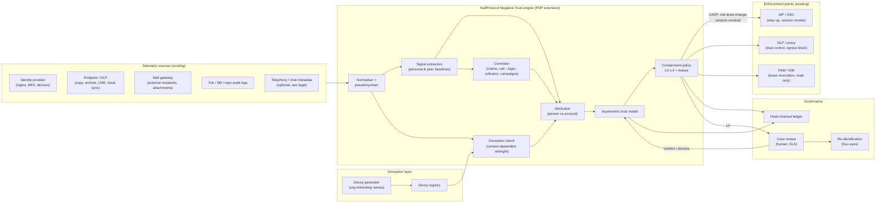
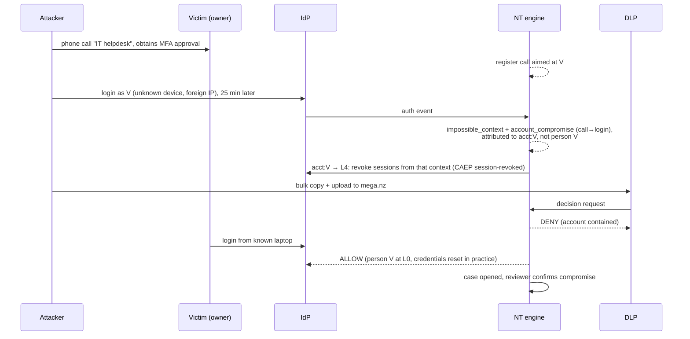
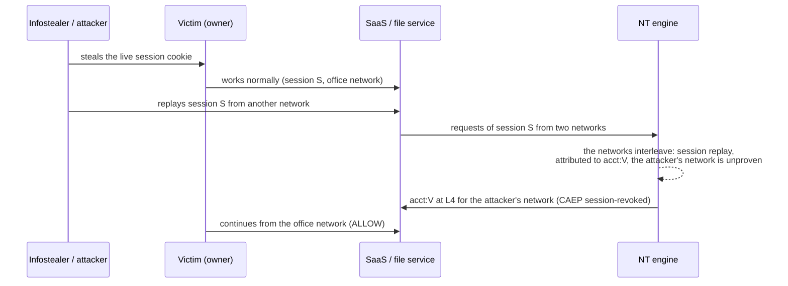
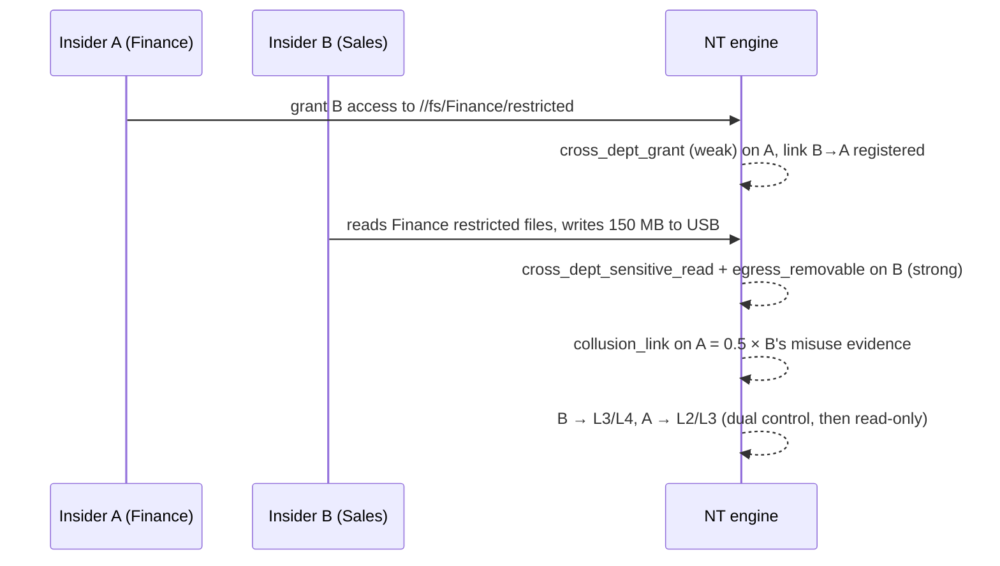

# Reference architecture

*Author: [github.com/amarkralj](https://github.com/amarkralj)*

## 1. Overview

## 2. Relation to NIST SP 800-207

NullProtocol Negative Trust is an **extension of the zero-trust architecture of NIST SP 800-207**, not a replacement. It keeps the
logical components of SP 800-207 and changes what the trust algorithm computes and how its result is enforced.

| NIST SP 800-207 component | In NullProtocol Negative Trust |
|---|---|
| Policy engine (PE) with trust algorithm | The NT engine. The trust algorithm is *score-based and contextual* (SP 800-207 §3.3.1), extended: trust is signed and starts at zero, misuse is remembered longer than good behaviour, evidence is attributed to the person *or* the account, and decoys create evidence actively |
| Policy administrator (PA) | Containment policy L0–L4: maps trust to step-up, dual control, read-only or isolation, and revokes purpose-bound access leases |
| Policy enforcement points (PEP) | Unchanged: identity provider, DLP / proxy, PAM. NT talks to them through OpenID CAEP signals and decision records |
| Data sources (activity logs, ID management, SIEM, threat intelligence) | Unchanged, read in the OCSF schema; plus the decoy registry |
| Access decision per request | Unchanged in principle; in addition, a decision can depend on *who* is behind a session (owner, colleague, outsider) |

In addition to "may this principal access this resource now?", the extended trust algorithm answers "what does the
evidence say about this principal, and how much should access be restricted?", for people and accounts that hold
legitimate access.

## 3. Components and their code

| Component | Responsibility | Code |
|---|---|---|
| Evidence | One record per observation that changes trust; weight, explanation, references, source | `src/npcore/evidence.py` |
| Signal extractors | Off-hours (personal profile), new device / foreign IP, cross-department sensitive reads, volume spikes, staging, egress, personal webmail, clone spikes, secrets in code, grants, optional message tone | `src/npcore/signals.py` |
| Deception | Organisation-mimicking decoys (files, credentials, accounts, records); evidence strength by class, interaction and scope | `src/npcore/deception.py` |
| Correlator | Staging → archive → egress chains; call/pretext → login on target's account; grant/forward → misuse (collusion, damped); multi-signal campaigns | `src/npcore/correlate.py` |
| Attribution | Evidence from unproven session contexts goes to `acct:<id>`, not to the person. Unproven contexts: unknown device and foreign network, a login right after a pretext call, a session used from two networks at once (stolen token), a colleague's account used from one's own device (evidence goes to the device owner). IT-support sessions are recorded, not scored | `src/npcore/engine.py` (`_attribute`, `_session_check`, `_device_check`, `session_level`) |
| Trust model | Signed trust, strong/weak half-lives, capped earned trust | `src/npcore/trust.py` |
| Proportionality | Beyond dual control only with evidence of intent; careless behaviour gets guard rails, not read-only access | `src/npcore/engine.py` (`_intent`) |
| Containment policy | Levels L0–L4, decision matrix, purpose-bound leases | `src/npcore/policy.py` |
| Ledger | SHA-256 hash chain over evidence, decisions, level changes, cases, re-identifications | `src/npcore/ledger.py` |
| Privacy | HMAC pseudonyms, four-eyes re-identification with logged reason | `src/npcore/privacy.py` |
| Engine | Streaming orchestration, case handling, review | `src/npcore/engine.py` |
| Integration | OCSF events in; decisions, level changes and OpenID CAEP SETs out; embedding API and HTTP service ([06-integration.md](06-integration.md)) | `src/npcore/integrations.py`, `api.py`, `serve.py` |

## 4. Sequence: hijacked account (vishing)

## 5. Sequence: stolen session token

## 6. Sequence: collusion

## 7. Deployment mapping

| NT input/output | Typical product category | Interface |
|---|---|---|
| Logins, MFA, devices | IdP (e.g. Entra ID, Okta, Keycloak) | sign-in logs as OCSF Authentication (3002); CAEP `risk-level-change` / `session-revoked` to the IdP |
| Copy/archive/USB/cloud sync | EDR / DLP | event export; policy API for block / approve |
| External mail | Mail gateway | message trace; hold-for-approval rule |
| File / DB / repo access | Audit logs (SMB/NFS audit, DB audit, Git server) | log shipping |
| Decoys | File shares, wiki, secrets store, directory, DB | decoy registry + access alerts |
| Ledger anchor | WORM storage or external timestamping (RFC 3161) | periodic head-hash anchoring (roadmap) |

## 8. Migration path from zero trust

1. **Observe:** run NT in shadow mode next to the existing zero-trust stack, pseudonymised, nothing enforced. Learn
   the baselines (routine channels, partner domains, shared machines) and set the thresholds to a case budget the
   organisation can review. This step is required; settings do not transfer between organisations.
2. **Deceive:** deploy decoys after informing employees (and their representatives where applicable); alert only.
3. **Verify:** enable L1 (step-up) and L2 (dual control on egress); both are low-impact and reversible.
4. **Contain:** enable L3/L4 with a staffed review rota and a review deadline.

## 9. Scalability

Pure Python, one core: SCALE_EPS events per second in the 1,000-employee test (about 1.9 million events per
organisation and 90 days), including the evaluation harness. Per-event cost is linear in the evidence held for one
subject, which decay keeps bounded; evidence whose remaining effect is below 10⁻⁶ is dropped from the computation
(it stays in the ledger). Horizontal scaling is by partitioning subjects; only correlation needs a shared index
(calls, grants, forwards, sessions).
